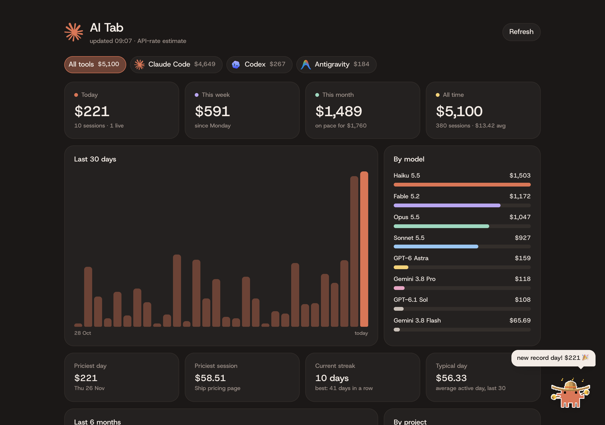
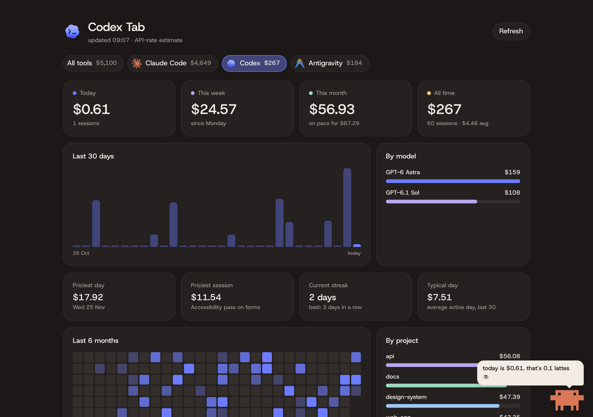
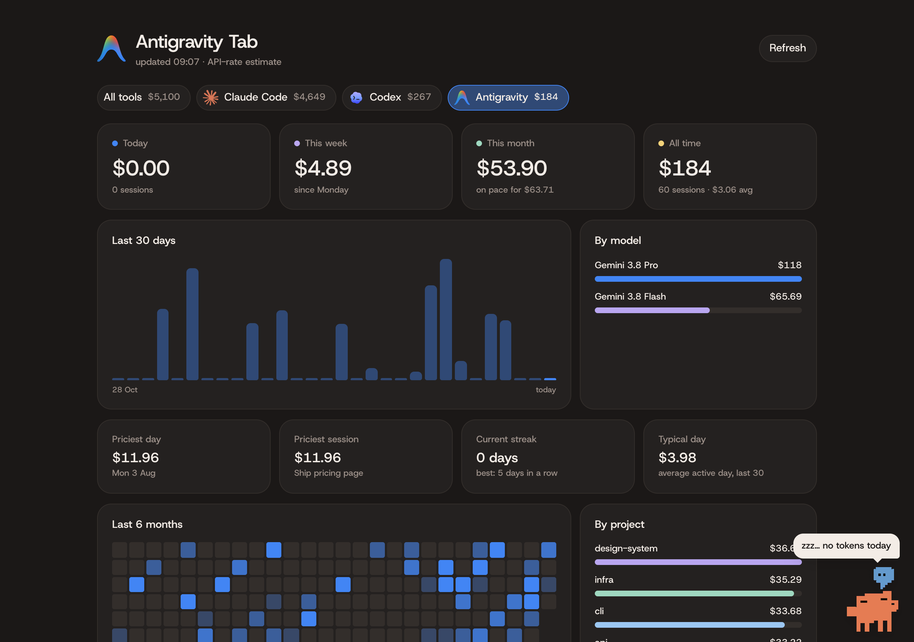
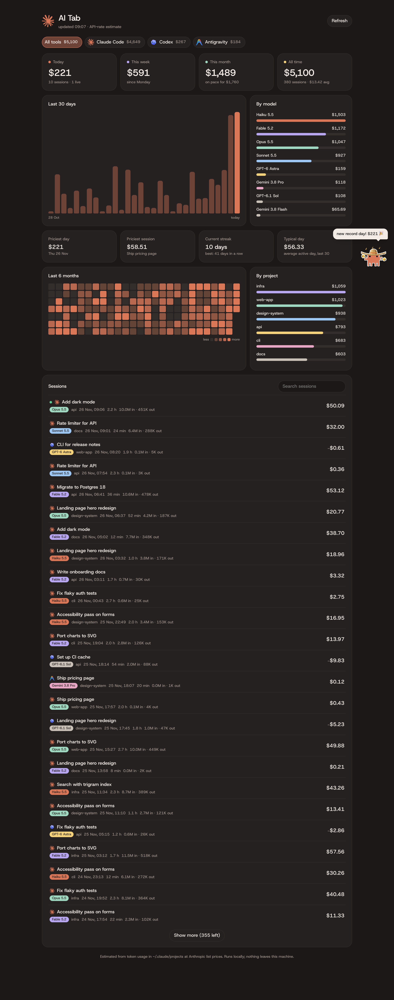

<p align="center"></p>

<h1 align="center">AI Tab</h1>

<p align="center">See what your Claude Code, Codex and Antigravity sessions would cost at API rates.<br>
Runs on your machine, reads your local logs, sends nothing anywhere.</p>

<p align="center"></p>

## Why

On a subscription you never see a bill. AI Tab prices every session as if you'd paid per token, so you know what your plan is actually worth.

## Features

- **Per-session cost** for every Claude Code session, with its title, project, model and a live dot while it's running
- **Codex and Antigravity tabs**, each in its own colour, plus an "All tools" total
- **Today / week / month / all time**, with a monthly pace projection
- **Last 30 days** bar chart and a **6-month heatmap**
- **Breakdowns** by model and by project
- **Records**: priciest day, priciest session, current and best streak, typical day
- **A pixel Clawd pet** that reacts to your spending: it walks while a session runs, sweats through a fire on an expensive day, and breaks out the maracas on a record day. Click it for a costume.

| Codex | Antigravity |
|---|---|
|  |  |

<details><summary>Full page</summary></details>

## Install

You need **Node.js 24 or newer** (it uses the built-in `node:sqlite`). No dependencies to install.

```bash
git clone https://github.com/xa1w/claude-costs.git
cd claude-costs
node server.mjs
```

Open <http://localhost:3240>. Use `PORT=4000 node server.mjs` to pick another port.

The first load scans all your logs and can take a few seconds; after that, results are cached in `.cache.json` and only changed files are re-read.

Want to try it without your own data? `DEMO=1 node server.mjs` serves made-up sessions (that's what the screenshots use).

## Where the numbers come from

| Tool | Reads | Accuracy |
|---|---|---|
| Claude Code | `~/.claude/projects/**/*.jsonl` | Exact token counts per message, deduplicated across resumed sessions. Cache writes are priced at 1.25× input (5 min) and 2× input (1 h). |
| Codex | `~/.codex/state_5.sqlite` | **Estimate** (shown with `~`). Codex only stores one token total per thread, so it's priced with an assumed 90% cached input / 8% fresh input / 2% output mix. |
| Antigravity | `~/.gemini/antigravity*/conversations/*.db` | Input and output tokens per turn. Older conversations stored only as `.pb` files aren't counted. |

Prices are a hand-kept table at the top of `server.mjs`. Update it when new models ship, and run `node check.mjs` to sanity-check the maths. Non-Claude prices come from public price lists and may drift.

The server listens on `127.0.0.1` only and never makes network requests.

## Credits

- Pixel Clawd animations from [ClawdMoji](https://github.com/afspies/ClawdMoji) (MIT, unofficial fan project); see `clawd/README.txt`
- Codex and Antigravity icons from [LobeHub Icons](https://github.com/lobehub/lobe-icons) (MIT)
- Claude, Clawd and the Anthropic spark belong to Anthropic, PBC. Codex belongs to OpenAI and Antigravity to Google. This is an unofficial project, not affiliated with any of them.

## License

MIT
